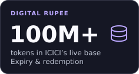
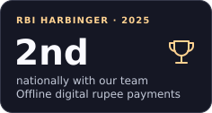
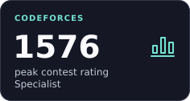

<h1 align="center">Hey 👋, I’m Jayant Singh Bhadauria</h1>

<strong>Software engineer at Sarvatra Technologies · Pune, India</strong> I write the Java behind digital rupee payment recovery.

### What I work on

💸 **Digital rupee payments** · I built the engine that recovers failed transfers at ICICI, PNB and SBI.

🔁 **[Sentinel-Ledger](https://github.com/jayantsB123/Sentinel-Ledger)** · My Spring Boot payment gateway. [Follow a retry](https://github.com/jayantsB123/Sentinel-Ledger/blob/main/src/main/java/com/jayant/payment/Sentinel_Ledger/service/impl/PaymentServiceImpl.java) to see why I check Redis twice before moving money.

🎨 **[Sorting Visualizer](https://github.com/jayantsB123/Dynamic-Sorting-Visualizer)** · I built a React playground for five sorting algorithms. [Watch quicksort run.](https://github.com/jayantsB123/Dynamic-Sorting-Visualizer/blob/master/public/assets/_quickSort.gif)

### Find me

   

 

### Languages & tools

 &nbsp;  &nbsp;  &nbsp;  &nbsp;  &nbsp;  &nbsp;  &nbsp;  &nbsp;  &nbsp; 

### A few numbers from my work and contests

  

