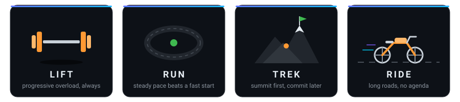
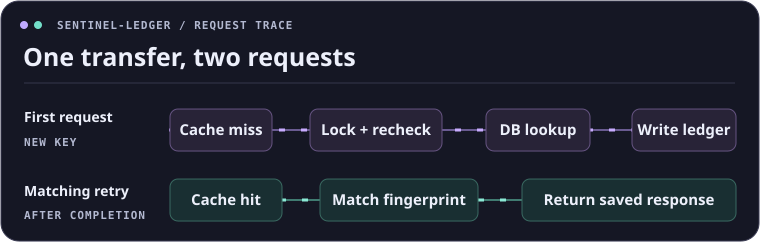

<!-- profile-cycle:start -->

<a href="./assets/profile-cycle/circuit.svg">Circuit</a> · <a href="./assets/profile-cycle/garage.svg">Garage</a> · <a href="./assets/profile-cycle/terminal.svg">Developer OS</a> · <a href="./assets/profile-cycle/city.svg">City</a> · <a href="./assets/profile-cycle/universe.svg">Universe</a>

<!-- profile-cycle:end -->

# Hey, I'm Jayant Singh Bhadauria 👋

**Java Backend Engineer · Full-Stack Developer · Competitive Programmer**

📍 Pune, India

I build scalable backend systems, engineer reliable payment workflows, and enjoy solving problems that make computers do interesting things.

Mostly found somewhere between **Java, Spring Boot, distributed systems, and a ridiculously difficult DSA problem.**

   

 

### 🧗 But life isn't just about coding

### 🇮🇳 CBDC & UPI developer · currently building India's Digital Rupee (e₹)

### [Sentinel-Ledger](https://github.com/jayantsB123/Sentinel-Ledger) · My payment gateway

What should happen when a transfer succeeds but the client times out and sends it again? I built a double-entry gateway in **Java and Spring Boot** to handle that case. Redis coordinates concurrent requests. PostgreSQL holds the ledger and enforces a unique idempotency key. A SHA-256 fingerprint catches a reused key with a different amount or destination.

[Read the retry logic →](https://github.com/jayantsB123/Sentinel-Ledger/blob/main/src/main/java/com/jayant/payment/Sentinel_Ledger/service/impl/PaymentServiceImpl.java)

### 🏆 Trophy shelf

| Event | Result |
| --- | --- |
| 🥈 RBI Harbinger 2025 | **2nd nationally** with our offline digital rupee team |
| 💻 MLH Fellowship | Selected among the **top 100 students across Asia** |
| 🏆 Tally CodeBrewers 2023 | **Top 10** out of **12,200+ teams** nationwide |
| 🎯 INNERVE 6.0 | **Top 5 finalist** in an event with **85,000+ registrations** |
| ⚡ [Codeforces](https://codeforces.com/profile/response_404) & [LeetCode](https://leetcode.com/u/MidnightSnarl/) | **Specialist** on Codeforces, peak **1576**. Solved **1,000+ problems** across both platforms. |

### 🛠️ Toolbox

<strong>Explore my full engineering stack</strong>

| Area | Skills |
| --- | --- |
| Languages & frameworks | Java 8/11/17, C++, Python, JavaScript, React, Angular |
| Backend & APIs | Spring Boot, Hibernate/JPA, REST APIs, microservices, event-driven architecture, jPOS (Q2, TransactionManager, Space) |
| Concurrency & resilience | Multithreading with Java executors, distributed locking, idempotency, fault tolerance |
| Messaging & caching | Kafka, RabbitMQ, Redis |
| Databases | Oracle, PostgreSQL, MySQL, SQL query optimization |
| Infrastructure & delivery | Docker, Kubernetes, Git, GitHub, Gradle, Flyway |
| Testing & quality | Unit testing, JUnit, Mockito, test-driven validation, secure coding |
| Engineering fundamentals | Data structures and algorithms, object-oriented design, distributed systems design |

### 📈 GitHub activity

  

  
  

### 🎞️ Contribution visualizations

The banner above cycles through five representations of my contribution calendar. [Original contribution replay (19 Nov 2026)](./assets/contribution-replay.svg).

### 📌 From my pins

  
  

----

  <i>"The best adventures happen outside your comfort zone — whether it's a production system, a mountain trail, or an unfamiliar road."</i>

  <b>Thanks for stopping by! Now go build something cool. 👨‍💻</b>

