# Hey, I'm Jayant Singh Bhadauria 👋

**Java Backend Engineer · Full-Stack Developer · Competitive Programmer**

📍 Pune, India

I build scalable backend systems, engineer reliable payment workflows, and enjoy solving problems that make computers do interesting things.

Mostly found somewhere between **Java, Spring Boot, distributed systems, and a ridiculously difficult DSA problem.**

But life isn't just about shipping code.

🏍️ Long rides · 🏔️ Trekking trails · ✈️ Spontaneous trips · 🏋️ Gym sessions · 🏃 Running · ♟️ Chess battles

Basically, I enjoy building things, breaking puzzles, and finding new ways to challenge myself.

**Code hard. Lift heavy. Ride far. Repeat.**

  
  
  
  
  

 

---

## ⚡ Building India's Digital Rupee

### CBDC & UPI DEVELOPER

Currently building **India's Digital Rupee (e₹)** — working on payment infrastructure, transaction processing, wallet provisioning, recovery mechanisms and resilient backend systems.

My work contributes to digital currency infrastructure across **ICICI, PNB and SBI**, with a focus on making financial transactions reliable, scalable and resilient.

From high-throughput token redemption to offline wallet recovery, I enjoy working on systems where reliability isn't optional.

**A little highlight:** Our offline Digital Rupee solution secured **2nd place nationally at RBI Harbinger 2025.** 🥈

---

## 🏆 Beyond the Terminal

I like competing, building things under pressure, and occasionally making computers solve problems that I probably shouldn't have spent three hours on.

| Adventure | Achievement |
| :--- | :--- |
| 🥈 **RBI Harbinger 2025** | 2nd nationally — Offline Digital Rupee solution |
| 💻 **MLH Fellowship** | Selected among the top 100 students across Asia |
| 🏆 **Tally CodeBrewers 2023** | Top 10 out of 12,200+ teams |
| 🎯 **INNERVE 6.0** | Top 5 finalist in an event with 85,000+ registrations |
| ⚡ **Codeforces** | Specialist · Peak rating 1576 |
| 🧩 **LeetCode + Codeforces** | 1,000+ problems solved across both platforms |

---

## 🛠️ My Engineering Playground

<strong>Explore my full engineering toolkit</strong>

 

| Domain | Technologies |
| :--- | :--- |
| Languages | Java 8/11/17, C++, Python, JavaScript |
| Frontend | React, Angular |
| Backend | Spring Boot, Hibernate/JPA, REST APIs, Microservices |
| Payment Systems | jPOS, Q2, TransactionManager, Space |
| Distributed Systems | Multithreading, Distributed Locking, Idempotency, Fault Tolerance |
| Messaging | Apache Kafka, RabbitMQ |
| Caching | Redis |
| Databases | Oracle, PostgreSQL, MySQL |
| DevOps & Tools | Docker, Kubernetes, Git, GitHub, Gradle, Flyway |
| Testing | JUnit, Mockito, Postman, JMeter |
| Fundamentals | Data Structures, Algorithms, OOP, System Design |

---

## 📊 GitHub Activity

  

  
  

---

## 🔥 Contribution Replay

---

## 🚀 Things I've Built

  
  

  

---

  <i>"The best adventures happen outside your comfort zone — whether it's a production system, a mountain trail, or an unfamiliar road."</i>

  <b>Thanks for stopping by! Now go build something cool. 👨‍💻</b>

