<h1 align="center">Hey 👋, I’m Jayant Singh Bhadauria</h1>

<strong>Software Development Engineer at Sarvatra Technologies · Pune, India</strong> I build systems that recover failed digital rupee payments, redeem expiring tokens, and provision wallets safely across servers.

### Digital rupee engineering

**Payment recovery.** I built the reconciliation engine used by ICICI, PNB and SBI. It handles four ways to recover funds after a failed digital rupee transaction, following RBI and NPCI settlement rules.

**Programmable tokens.** I built the expiry and redemption engine running at ICICI, where the live base exceeds 100 million tokens. I reworked its SQL and concurrency handling and validated **100,000+ redemptions per hour** across multiple nodes in user acceptance testing (UAT).

**Offline payments.** I extended the reconciliation architecture for our offline digital rupee entry at RBI Harbinger 2025. Our team placed **second nationally**.

   

 

<strong>More of my work at Sarvatra</strong> · January 2025–present

**Software Development Engineer · July 2025–present**

- I designed Aadhaar-based wallet provisioning for a rollout covering 13M+ users. Distributed locks coordinate workers, idempotent retries prevent duplicate wallets, and compensating steps roll back partial work.
- I designed a Kafka-based wallet-blocking service for ICICI to handle simultaneous block requests across nodes. I also implemented hybrid AES-256/RSA encryption for sensitive SMS gateway payloads in ICICI and PNB’s PMGKAY disbursement flow.
- The programmable-token engine was Sarvatra’s winning showcase at Global Fintech Fest 2025. Beyond ICICI, the engine reached UAT at SBI, PNB, IDFC, IDBI, Indus and CBI.

**Software Developer Intern · January–June 2025**

I shipped a centralized payment-log stack using Docker, Elasticsearch, Logstash and Kibana. I also designed Account-Check, which validates bank accounts before a transaction and reports specific failure codes to the payment channel.

### [Sentinel-Ledger](https://github.com/jayantsB123/Sentinel-Ledger) · My payment gateway

What should happen when a transfer succeeds but the client times out and sends it again? I built a double-entry gateway in **Java and Spring Boot** to handle that case. Redis coordinates concurrent requests. PostgreSQL holds the ledger and enforces a unique idempotency key. A SHA-256 fingerprint catches a reused key with a different amount or destination.

[Read the retry logic →](https://github.com/jayantsB123/Sentinel-Ledger/blob/main/src/main/java/com/jayant/payment/Sentinel_Ledger/service/impl/PaymentServiceImpl.java)

### Hackathons, fellowship & competitive programming

| Event | Result |
| --- | --- |
| 🥈 RBI Harbinger 2025 | **2nd nationally** with our offline digital rupee team |
| 💻 MLH Fellowship | Selected among the **top 100 students across Asia** |
| 🏆 Tally CodeBrewers 2023 | **Top 10** out of **12,200+ teams** nationwide |
| 🎯 INNERVE 6.0 | **Top 5 finalist** in an event with **85,000+ registrations** |
| ⚡ [Codeforces](https://codeforces.com/profile/response_404) & [LeetCode](https://leetcode.com/u/MidnightSnarl/) | **Specialist** on Codeforces, peak **1576**. Solved **1,000+ problems** across both platforms. |

### Languages & tools

 &nbsp;  &nbsp;  &nbsp;  &nbsp;  &nbsp;  &nbsp;  &nbsp;  &nbsp;  &nbsp; 

**Backend** · Java, Spring Boot, Hibernate/JPA, jPOS, Kafka, RabbitMQ  
**Data & testing** · Oracle, PostgreSQL, MySQL, Redis, Flyway, JUnit, Mockito

**Education** · B.E. in Computer Engineering, Army Institute of Technology, Pune · 2021–2025 · CGPA **8.95**

### GitHub activity

  

  
  

